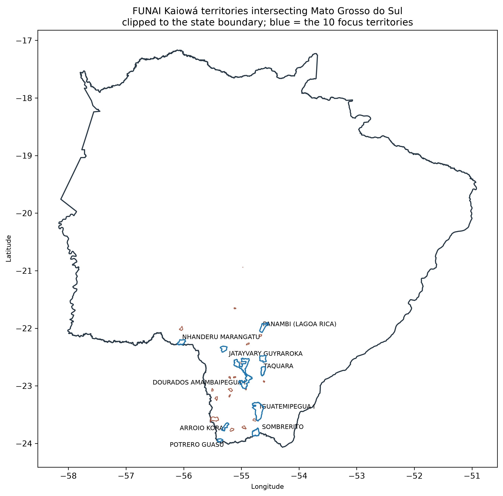

![note] This is an intermediary reproducible guide that uses Python to programmatically extract the case records from the CIMI reports, cross-reference them with the FUNAI territory polygons, and query the MapBiomas land-cover classification inside those polygons. The entire code can be found in our [Soberana Land Rights Monitor](https://github.com/Soberana-Sensing/soberana-land-rights-monitor/tree/main/cimi).

[[toc]]

# Introduction

After the second round of the Brazilian presidential election on 25 October 2026, the Guarani-Kaiowá Indigenous communities in Mato Grosso do Sul (MS) reported a wave of violence: [threats to poison the water of the Sassoró village in Tacuru](https://g1.globo.com/ms/mato-grosso-do-sul/noticia/2026/11/01/ataque-a-indigenas-em-ms-o-que-se-sabe-sobre-ameacas-de-envenenamento-da-agua-em-aldeia.ghtml), [death threats](https://www.poder360.com.br/poder-brasil/governo-cria-forca-tarefa-para-apurar-ataques-a-indigenas-no-ms/), [hit-and-runs](https://agenciabrasil.ebc.com.br/direitos-humanos/noticia/2026-10/indigenas-de-ms-denunciam-casos-de-violencia-e-ameacas-apos-eleicao), and the [burning of the home and sacred objects of a 90-year-old spiritual leader in Jaguapiré](https://agenciabrasil.ebc.com.br/radioagencia-nacional/direitos-humanos/audio/2026-10/ms-indigenas-denunciam-ameacas-e-violencia-apos-resultado-de-eleicao). APIB, the national Indigenous umbrella body, had counted [more than 30 cases](https://www.poder360.com.br/poder-brasil/governo-cria-forca-tarefa-para-apurar-ataques-a-indigenas-no-ms/) of threats, attacks and hit-and-runs against Indigenous people in the state related to the 2026 election by the end of October. [Federal prosecutors opened investigations](https://www.mpf.mp.br/o-mpf/unidades/pr-ms/noticias/mpf-abre-investigacoes-sobre-onda-de-violencia-e-ataques-contra-comunidades-indigenas-em-mato-grosso-do-sul) and the [National Force was deployed to three villages](https://g1.globo.com/ms/mato-grosso-do-sul/noticia/2026/10/30/forca-nacional-faz-patrulhamento-em-aldeias-indigenas-de-ms-apos-ameacas-de-envenenamento-da-agua.ghtml). This recent surge of violence prompted us to do a research on the land-cover transformation inside the Guarani-Kaiowá territories within the MS state.

In this analysis we used three sources of information:

1. **CIMI reports (2008–2025)**: the annual [_Violence against Indigenous People in Brazil_](https://cimi.org.br/observatorio-da-violencia/edicoes-anteriores/) series, published by the missionary body of the Catholic Church in Brazil (CIMI). Each edition records, case by case and territory by territory, the attacks reported in the previous year.
2. **Polygons with the limits of the indigenous territories in the state of MS**, from [FUNAI](https://www.gov.br/funai), Brazil's federal Indigenous agency, downloaded as a single [WFS request](https://geoserver.funai.gov.br/geoserver/Funai/ows?service=WFS&version=2.0.0&request=GetFeature&typeNames=Funai:tis_poligonais_portarias&outputFormat=application/json&srsName=EPSG:4674&CQL_FILTER=uf_sigla%3D%27MS%27) filtered to the state of Mato Grosso do Sul.
3. **MapBiomas land use and land cover**, [collection 11](https://brasil.mapbiomas.org/colecoes-mapbiomas), which classifies every 30 m pixel of Brazil once a year from 1985 to 2025.

CIMI documents the pressure on each territory, year after year; while FUNAI's geospatial inventory gives information on the location of each territory and how far the state has gone in recognising them. 

## What CIMI records

In this study we focus on the first chapter of the CIMI report, which covers **violence against Indigenous heritage**: for example, disputes over land, delays in regularisation, and the use and degradation of natural resources. Between the 2008 and 2025 editions, 44 different Guarani-Kaiowá territories (pluts two encampments) in Mato Grosso do Sul are mentioned in their Chapter 1. 

*Figure 1* summarises 209 cases, showing a steep increase in violence related to land-right conflicts and posessory invasions.

. The colour gives the conflict type CIMI assigns to the cases of that territory-year: disputes over territorial rights (blue), invasions of possession, illegal exploitation of natural resources and damage to property (brown), and omission and slowness in land regularisation (cyan). The number counts the cases; grey marks territory-years with no recorded case.")

The reports also record, although sparsely, how much of the delimited area the community actually holds. *Figure 2* shows their findings from the 2020 edition.

The spread is wide: the community of Ñande Ru Marangatu holds about 5,400 ha of its 9,317 ha delimited territory (57.96%), while Iguatemipegua I holds 98 ha of 41,571 ha (0.24%). 

## What FUNAI registers

Each polygon in FUNAI's inventory carries a status field recording how far the territory has advanced through the administrative recognition process. The five stages, from weakest to strongest legal footing are as follows:

| Status | What it means | Practical legal strength |
| --- | --- | --- |
| **Em estudo** (in study) | FUNAI is conducting anthropological, historical, land-tenure, cartographic and environmental studies to identify and delimit the Indigenous territory. | Weakest formal stage; the proposed perimeter is still under technical analysis and can change. |
| **Delimitada** (delimited) | The studies are complete and approved by FUNAI's presidency; the proposed limits are published in the federal and state official gazettes. | A formal proposed boundary exists, but it is not yet a presidentially declared Indigenous land. |
| **Declarada** (declared) | The Ministry of Justice reviews the case and, if appropriate, declares the limits and orders physical demarcation through a portaria in the Diário Oficial da União. | Stronger: the State has formally recognised the limits and ordered demarcation. |
| **Homologada** (homologated) | The materialised, georeferenced boundaries are published by presidential decree; the area is thereby constituted as a Terra Indígena. | Very strong: this is the decisive federal recognition of the TI's boundaries. |
| **Regularizada** (regularized) | After homologation, FUNAI helps the Secretariat of Federal Patrimony (SPU) register the area in the property registry and in SPU records. | Strongest administrative completion: the homologated territory has been formally registered. |

Note that a territory only moves from declared to homologated by presidential decree. CIMI also records how many territories were homologated by each president in Brasil. *Figure 3* reproduces that table from their latest report.

 is highlighted in yellow.")

It's important to note that:

1. Of the 46 territory labels in *Figure 1*, 20 match a polygon in FUNAI's data. Three of those labels name a reserve or municipality, so the match means "in or around".
2. FUNAI's download holds 25 polygons with Guarani-Kaiowá in the ethnicity field (23 single-label, 2 mixed). 11 have no Chapter I case attributed to the Kaiowá; some appear elsewhere in the reports.
3. Of the 20 CIMI labels with a polygon, 14 are Kaiowá in FUNAI, 5 are Nhandeva or Nhandeva+Terena (Cerrito, Dourados, Porto Lindo, Ypoi/Triunfo, Yvy Katu), and one is Guaraní (Dourados-Amambaipeguá I). Two further inventory territories, Sombrerito and Potrero Guaçu, are Nhandeva in FUNAI.

## Ten focus territories

For the land-cover analysis we take every territory in *Figure 2*, the ten that CIMI lists with an occupied share in its 2020 edition: Arroio Korá, Dourados-Amambaipeguá I, Guyraroká, Iguatemipegua I, Jatayvary, Ñande Ru Marangatu, Panambi–Lagoa Rica, Potrero Guaçu, Sombrerito and Taquara. The table below summarises their statistics, including their current legal stage, according to FUNAI's data.

| Territory | Municipality | Area (ha) | First legal act | Stage today | Occupied (2020) |
| --- | --- | --- | --- | --- | --- |
| Arroio Korá | Paranhos | 7,175 | Delimited, 17 Aug 2004 | Homologada | 4,000 ha (55.7%) |
| Dourados-Amambaipeguá I | Amambai, Dourados and Naviraí | 55,600 | Delimited, 12 May 2016 | Delimitada | 4,594 ha (8.26%) |
| Guyraroká | Caarapó | 11,440 | Delimited, 12 Aug 2004 | Declarada | 50 ha (0.44%) |
| Iguatemipegua I | Iguatemi | 41,571 | Delimited, 7 Jan 2013 | Delimitada | 98 ha (0.24%) |
| Jatayvary | Ponta Porã | 8,800 | Delimited, 1 Sep 2005 | Declarada | 108 ha (1.23%) |
| Ñande Ru Marangatu | Antônio João | 9,317 | Declared, 30 Oct 2002 | Homologada | 5,400 ha (57.96%) |
| Panambi–Lagoa Rica | Douradina and Itaporã | 12,196 | Delimited, 9 Dec 2011 | Delimitada | 390 ha (3.2%) |
| Potrero Guaçu | Paranhos | 4,025 | Declared, 13 Apr 2000 | Declarada | 1,000 ha (24.84%) |
| Sombrerito | Sete Quedas | 12,608 | Delimited, 4 Jul 2006 | Declarada | 600 ha (4.76%) |
| Taquara | Juti | 9,700 | Delimited, 2 Dec 2005 | Declarada | 1,881 ha (19.4%) |

*Figure 4* below showcases all Guarani-Kaiowá territories according to FUNAI's geospatial data, the 10 we are going to focus are highlighted in blue.

# Land cover inside the ten territories

To see what the disputes look like on the ground, we crossed the FUNAI polygons with MapBiomas collection 11. For each of the ten territories we grouped MapBiomas' 33 legend classes into the following six: native vegetation, pasture, agriculture (soy, cane, rice, cotton and other temporary and perennial crops), mosaic of uses, forest plantation and other non-vegetated areas; plus water and pixels MapBiomas does not classify. The mosaic of uses class marks land where farming or grazing dominates in a patchwork of different uses: typically smallholder properties where crop fields, pasture and residual native vegetation are mixed too finely for MapBiomas to resolve into a single class. The result is one stacked-area chart per territory, in hectares, covering the whole 1985–2025 series. Vertical dashed lines mark the FUNAI acts recorded for that territory: delimitation (indigo), declaration (amber) and homologation/ratification (purple). *Figure 6* arranges the ten panels in a 5 x 2 grid.

. Colours follow the six groups used in the text plus water and pixels MapBiomas does not classify; the legend is in Portuguese. The black dashed line marks the year of the territory's first legal act in the FUNAI inventory, labelled with that act and the stage recorded in the 2026 inventory.")

# Discussion 

Between 1985 and 2025, native vegetation fell in eight of the ten territories: 3,046 ha in Iguatemipegua I, 2,268 ha in Dourados-Amambaipeguá I, 2,105 ha in Sombrerito, 671 ha in Jatayvary, 647 ha in Potrero Guaçu, 595 ha in Ñande Ru Marangatu, 350 ha in Arroio Korá and 194 ha in Panambi–Lagoa Rica. The two exceptions, Guyraroká (+684 ha) and Taquara (+407 ha), gained native cover while losing pasture. That is consistent with regrowth on abandoned pasture.

Agriculture expanded in all ten, but the scale is uneven: 16 ha in Arroio Korá and 180 ha in Potrero Guaçu at one end, 39,735 ha in Dourados-Amambaipeguá I at the other. In four territories the gain tracks the pasture loss closely: Dourados-Amambaipeguá I (+36,616 ha agriculture, −36,589 ha pasture), Guyraroká (+6,134/−6,989), Panambi–Lagoa Rica (+2,779/−2,713) and Taquara (+7,197/−8,266). In Jatayvary the gain (+6,455 ha) is close to the combined pasture and mosaic loss (−3,008 and −2,932 ha). The pattern is the familiar Cerrado sequence: native cover cleared for pasture, then pasture renewed as cropland. 

MapBiomas records land cover, not land user. The agriculture group in this analysis is a set of mechanized crop classes (soy, cane, rice, cotton and other annual and perennial crops), not a label of who farms. The inference that most of this area is non-indigenous commercial farming is strong where the community holds a small share of the polygon: Guyraroká 0.44%, Jatayvary 1.23% and Dourados-Amambaipeguá I 8.26%, against 71.5–73.9% agriculture. It is weaker where the community holds more land. It is also incomplete: indigenous and smallholder cultivation is small, mixed and often mapped as mosaic or removed by the 30 m spatial filter. 

In the 2008–2025 corpus, no CIMI report records a lease agreed by the community in any of the ten. The two lease records that touch them are leases of farms that the communities are retaking, not leases granted by the community: the Fazenda Ipuitã overlap in Guyraroká ([CIMI 2025](https://cimi.org.br/relatorioviolencia2025)) and the Fazenda Cleto Spessato overlap in Panambi–Lagoa Rica (CIMI 2024). The systematic case CIMI documents is the Dourados reserve, outside the ten, where the MPF estimated in 2010 that half the arable area was leased to non-indigenous farmers. CIMI describes the arrangement as coercive; it is not free community consent. Leasing is prohibited by [Lei 6.001/1973, art. 18](https://www.planalto.gov.br/ccivil_03/leis/l6001.htm), and acts of occupation or exploitation over indigenous land are null under [CF/1988, art. 231 §6](https://www.planalto.gov.br/ccivil_03/constituicao/constituicao.htm), so consent does not make it lawful.

Homologation establishes the territory; titles and acts of occupation over it are null. The demarcation procedure is regulated by [Decreto 1.775/1996](https://www.planalto.gov.br/ccivil_03/decreto/d1775.htm), and removal of non-indigenous occupants is a separate administrative step. It did not stop agricultural expansion in Ñande Ru Marangatu. The territory was homologated in March 2005. MapBiomas records 38 ha of agriculture inside the polygon that year and 725 ha in 2025, a 19-fold increase (*Figure 5*). 

The two territories where the community holds most of the polygon look different. Arroio Korá (55.7% occupied) is 78% pasture, 12.5% mosaic, 8.6% native and 0.2% agriculture in 2025. Ñande Ru Marangatu (58.0%) is 35% pasture, 34% mosaic, 23% native and 8% agriculture. These are not crop landscapes. They are consistent with community cattle and small farming, but also with non-indigenous pasture on the 42–44% not occupied.

To conclude, three signals are worth reading together: 
1. agriculture expanding inside a polygon after its legal stage; 
2. the share of the polygon the community actually holds; and 
3. the lease, invasion and damage records in CIMI. 

A territory can be homologated and still lose land cover to crops; a territory can be 58% occupied and still have most of its area under pasture whose user is unknown. The 2026 wave of threats and attacks is the immediate political expression of a pressure that the land-cover series shows in slow motion.

# Resources

- Lopes, N. (2026, November 1). _Ataque a indígenas em MS: o que se sabe sobre ameaças de envenenamento da água em aldeia_. G1. https://g1.globo.com/ms/mato-grosso-do-sul/noticia/2026/11/01/ataque-a-indigenas-em-ms-o-que-se-sabe-sobre-ameacas-de-envenenamento-da-agua-em-aldeia.ghtml
- Machado, M. (2026, October 30). _Força Nacional faz patrulhamento em aldeias indígenas de MS após ameaças de envenenamento da água_. G1. https://g1.globo.com/ms/mato-grosso-do-sul/noticia/2026/10/30/forca-nacional-faz-patrulhamento-em-aldeias-indigenas-de-ms-apos-ameacas-de-envenenamento-da-agua.ghtml
- Balduino, I. (2026, October 29). _Indígenas de MS denunciam casos de violência e ameaças após eleição_. Agência Brasil. https://agenciabrasil.ebc.com.br/direitos-humanos/noticia/2026-10/indigenas-de-ms-denunciam-casos-de-violencia-e-ameacas-apos-eleicao
- Passos, G. (2026, October 30). _MS: indígenas denunciam ameaças e violência após resultado de eleição_. Radioagência Nacional. https://agenciabrasil.ebc.com.br/radioagencia-nacional/direitos-humanos/audio/2026-10/ms-indigenas-denunciam-ameacas-e-violencia-apos-resultado-de-eleicao
- Agência Brasil. (2026, October 30). _Governo cria força-tarefa para apurar ataques a indígenas no MS_. Poder360. https://www.poder360.com.br/poder-brasil/governo-cria-forca-tarefa-para-apurar-ataques-a-indigenas-no-ms/
- Procuradoria da República em Mato Grosso do Sul. (2026, October 28). _MPF abre investigações sobre onda de violência e ataques contra comunidades indígenas em Mato Grosso do Sul_. Ministério Público Federal. https://www.mpf.mp.br/o-mpf/unidades/pr-ms/noticias/mpf-abre-investigacoes-sobre-onda-de-violencia-e-ataques-contra-comunidades-indigenas-em-mato-grosso-do-sul
- Cimi – Conselho Indigenista Missionário. (2013, April 8). _Documento final do 4º Aty Guasu das Mulheres Guarani e Kaiowá_. https://cimi.org.br/2013/04/34598/
- Comissão Pastoral da Terra. (2017, January 12). _Indígenas estão ameaçados de despejo em Dourados (MS)_. https://cptnacional.org.br/2017/01/12/indigenas-estao-ameacados-de-despejo-em-dourados-ms
- Ministério Público Federal. (2014, August 22). _Após 13 anos, liminar é cassada e demarcação de terra indígena prossegue_. Republished by MST. https://mst.org.br/2014/08/22/apos-13-anos-liminar-e-cassada-e-demarcacao-de-terra-indigena-prossegue
- Dourados Agora. (2026, October 26). _Vereador defende compra de propriedades pela União para negociar conflito em Dourados_. https://www.douradosagora.com.br/noticias/politica/vereador-defende-compra-de-propriedades-pela-uniao-para-negociar-conflito-em-dourados
- Cimi – Conselho Indigenista Missionário. (2025). _Violência contra os povos indígenas no Brasil: Relatório 2025_. https://cimi.org.br/relatorioviolencia2025
- Fundação Nacional dos Povos Indígenas. (n.d.). _Funai_. https://www.gov.br/funai
- Fundação Nacional dos Povos Indígenas. (n.d.). _Terras Indígenas – polígonos por portarias (layer Funai:tis_poligonais_portarias)_. Geoserver Funai, WFS request filtered to Mato Grosso do Sul. https://geoserver.funai.gov.br/geoserver/Funai/ows?service=WFS&version=2.0.0&request=GetFeature&typeNames=Funai:tis_poligonais_portarias&outputFormat=application/json&srsName=EPSG:4674&CQL_FILTER=uf_sigla%3D%27MS%27
- MapBiomas. (2025). _Coleções MapBiomas: Collection 11 of annual land cover and land use maps of Brazil (1985–2025)_. https://brasil.mapbiomas.org/colecoes-mapbiomas
- Soberana Sensing. (n.d.). _Soberana Land Rights Monitor: CIMI pipeline_. GitHub. https://github.com/Soberana-Sensing/soberana-land-rights-monitor/tree/main/cimi