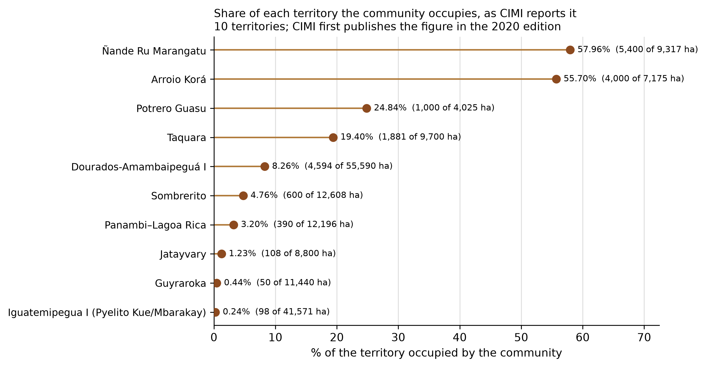

![note] This is an intermediary reproducible work that uses Python to programmatically extract the case records from the CIMI reports, cross-reference them with the FUNAI territory polygons, and query the MapBiomas land-cover classification inside those polygons. The entire code can be found in our [Soberana Land Rights Monitor](https://github.com/Soberana-Sensing/soberana-land-rights-monitor/tree/main/cimi).

[[toc]]

# Introduction

After the second round of the Brazilian presidential election on 25 October 2026, the Guarani-Kaiowá Indigenous communities in Mato Grosso do Sul (MS) reported a wave of violence: [threats to poison the water of the Sassoró village in Tacuru](https://g1.globo.com/ms/mato-grosso-do-sul/noticia/2026/11/01/ataque-a-indigenas-em-ms-o-que-se-sabe-sobre-ameacas-de-envenenamento-da-agua-em-aldeia.ghtml), [death threats](https://www.poder360.com.br/poder-brasil/governo-cria-forca-tarefa-para-apurar-ataques-a-indigenas-no-ms/), [hit-and-runs](https://agenciabrasil.ebc.com.br/direitos-humanos/noticia/2026-10/indigenas-de-ms-denunciam-casos-de-violencia-e-ameacas-apos-eleicao), and the [burning of the home and sacred objects of a 90-year-old spiritual leader in Jaguapiré](https://agenciabrasil.ebc.com.br/radioagencia-nacional/direitos-humanos/audio/2026-10/ms-indigenas-denunciam-ameacas-e-violencia-apos-resultado-de-eleicao). The Articulation of Indigenous Peoples of Brazil (APIB) had counted [more than 30 cases](https://www.poder360.com.br/poder-brasil/governo-cria-forca-tarefa-para-apurar-ataques-a-indigenas-no-ms/) of threats, attacks and hit-and-runs against Indigenous people in the state related to the 2026 election by the end of October. [Federal prosecutors opened investigations](https://www.mpf.mp.br/o-mpf/unidades/pr-ms/noticias/mpf-abre-investigacoes-sobre-onda-de-violencia-e-ataques-contra-comunidades-indigenas-em-mato-grosso-do-sul) and the [National Force was deployed to three villages](https://g1.globo.com/ms/mato-grosso-do-sul/noticia/2026/10/30/forca-nacional-faz-patrulhamento-em-aldeias-indigenas-de-ms-apos-ameacas-de-envenenamento-da-agua.ghtml). This recent surge of violence prompted the Soberana team to investigate how the land use and land cover (LULC) evolved inside the Guarani-Kaiowá territories within the MS state.

This analysis is primarily based on:

1. **CIMI reports (2009–2026)**: the annual [_Violence against Indigenous People in Brazil_](https://cimi.org.br/observatorio-da-violencia/edicoes-anteriores/) series, published by the missionary body of the Catholic Church in Brazil (CIMI). Each edition records, case by case and territory by territory, the attacks reported in the previous year.
2. **Geospatial data of the indigenous territories**, from [FUNAI](https://www.gov.br/funai), Brazil's federal Indigenous agency, downloaded as a single [WFS request](https://en.wikipedia.org/wiki/Web_Feature_Service) from [FUNAI's GeoServer](https://geoserver.funai.gov.br/geoserver/Funai/ows?service=WFS&version=2.0.0&request=GetFeature&typeNames=Funai:tis_poligonais_portarias&outputFormat=application/json&srsName=EPSG:4674&CQL_FILTER=uf_sigla%3D%27MS%27).
3. **MapBiomas land use and land cover (LULC)**, [collection 11](https://brasil.mapbiomas.org/colecoes-mapbiomas), which classifies the land of Brazil once a year from 1985 to 2025, with a spatial resolution of 30 m.

# Legal framework

Before diving into the report it is important to mention to the reader that an Indigenous land (Terra Indígena, TI) is an area the Brazilian State formally recognises as traditionally occupied by an Indigenous people. The 1988 Constitution recognises the Indigenous right to traditionally occupied land as an [original right, held before any private title existed](https://normas.leg.br/?urn=urn:lex:br:federal:constituicao:1988-10-05;1988!art231). This recognition follows the [fixed administrative sequence](https://www.gov.br/funai/pt-br/atuacao/terras-indigenas/demarcacao-de-terras-indigenas/fases-do-processo-administrativo) described in the table below.

| Status | What it means | Practical legal strength |
| --- | --- | --- |
| **Em estudo** (in study) | FUNAI is conducting anthropological, historical, land-tenure, cartographic and environmental studies to identify and delimit the Indigenous territory. | Weakest formal stage; the proposed perimeter is still under technical analysis and can change. |
| **Delimitada** (delimited) | The studies are complete and approved by FUNAI's presidency; the proposed limits are published in the federal and state official gazettes. | A formal proposed boundary exists, but it is not yet a presidentially declared Indigenous land. |
| **Declarada** (declared) | The Minister of Justice reviews the case and, if appropriate, declares the limits and orders physical demarcation through a *portaria* (decree) in the *Diário Oficial da União*. | The State has formally recognised the boundaries and ordered demarcation. |
| **Homologada** (ratified) | The materialised, georeferenced boundaries are published by presidential decree; the area is thereby constituted as a Terra Indígena (TI). | This is the decisive federal recognition of the TIs boundaries. |
| **Regularizada** (regularised) | After ratification, FUNAI helps the Secretariat of Federal Patrimony (SPU) register the area in the property registry and in SPU records. | Strongest administrative completion: the ratified territory has been formally registered. |

Non-Indigenous occupants of a ratified TI are [legally required to leave](https://www6g.senado.gov.br/apem/data/data/PROJ/71979.html). However, removal may be delayed until compensation has been paid for improvements made in good faith. Let is be noted that a territory only moves from declared to ratified by presidential decree.  CIMI's yearly report records the amount of TIs ratified per presidential term since 1985, shown in **Figure 1**.

# Areas of interest

CIMI's 2020 report recorded the area the indigenous community actually occupies within the Indigenous land as delimited by FUNAI for 10 distinct territories, shown in **Figure 2**. The figure highlights a large disparity in occupied land. The community of Ñande Ru Marangatu inhabited approximately 58% of their delimited territory in 2020, while in Iguatemipegua I and Guyraroka, they occupied less than 0.5% of the land. 

**Figure 3** showcases all Guarani-Kaiowá territories, within the state of Mato Grosso do Sul, according to FUNAI's geospatial data; the 10 we are focusing on are the ones presented in **Figure 2** and they are highlighted in blue.

The first chapter of each CIMI yearly report covers **violence against Indigenous heritage**: for example, disputes over land, delays in regularisation, and the use and degradation of natural resources. **Figure 4** summarises all cases across our areas of interest between 2008 and 2025. The figure shows a steep increase in violence related to land-right conflicts (dark blue) and possessory invasions (brown) in the past decade.

. The colour indicates the conflict type CIMI assigns to each case: disputes over territorial rights (dark blue), invasions of possession, illegal exploitation of natural resources and damage to property (brown), and omission and slowness in land regularisation (cyan). The number counts the cases in each territory-year.")

# Land use and land cover (LULC) analysis

We start by overlaying the ten delimited TI polygons downloaded from FUNAI's GeoServer with the MapBiomas collection 11 dataset, which classifies land use in 33 distinct classes. To keep the plots readable, we aggregated those 33 classes into the following eight groups: 

1. **Native vegetation**. It includes forest formation, floodable forest, savanna formation, flooded savanna, mangrove, wooded sandbank vegetation, grassland formation, herbaceous and shrub formation, wetland, salt marsh, herbaceous sandbank vegetation, hypersaline tidal flat and rocky outcrop.

2. **Pasture**. Grassland used for grazing.

3. **Agriculture**. It includes soybean, sugar cane, rice, cotton, other temporary crops, coffee, citrus, palm oil and other perennial crops. Likely by commercial agribusiness operations, particularly large-scale mechanised cropping.

4. **Mosaic of uses**. Land where crop fields, pasture and residual native vegetation are mixed too finely for the 30 m resolution to resolve, typical of smallholder properties such as Indigenous communities.

5. **Forest plantation**. Planted trees for commercial use, mostly eucalyptus and pine.

6. **Other non-vegetated areas**. It includes beach, dune and sand, urban area, exposed soil, mining, photovoltaic plant, wind farm and any other non-vegetated surfaces.

7. **Water**. It includes river, lake, ocean and aquaculture.

8. **Unclassified**. Pixels MapBiomas does not classify.

**Figure 5** shows the LULC change between 1985 and 2025 in the ten analysed Indigenous Territories. We observe that *native vegetation* reduced in eight of the ten territories, with two exceptions; Guyraroká and Taquara, where it increased by 684 ha and 407 ha, respectively. 

*Agriculture* expanded substantially in eight territories, whereas *pasture* declined in all of them. In four territories, agricultural expansion was largely offset by pasture loss: Dourados-Amambaipeguá I (+36,616 ha agriculture, −36,589 ha pasture), Guyraroká (+6,134/−6,989), Panambi–Lagoa Rica (+2,779/−2,713) and Taquara (+7,197/−8,266). In Jatayvary, the agricultural gain (+6,455 ha) was similar to the combined decline in pasture and mosaic areas (−3,008 and −2,932 ha, respectively). This pattern is consistent with the [commonly observed pasture-to-crop conversion in the region](https://link.springer.com/article/10.1007/s44274-024-00150-1?).

 inside the ten focus territories, 1985–2025. Each panel is a stacked area chart in hectares from MapBiomas Collection 11. Colours follow the eight groups used. The blue dashed line marks the year of the FUNAI's delimitation, the orange dashed line marks the year of the demarcation, and the continuous purple line marks the year of ratification.")

# Discussion

Explain what a company needs to do after declaration and ratification; when it becomes illegal to continue (and grow) their operations in the land, and when its bad-faith.

MapBiomas identifies land cover, not ownership, tenure or who carries out the farming. The inference is stronger in territories where the communities occupy only a small fraction of the polygon. In Guyraroká, Iguatemipegua I and Dourados-Amambaipeguá I, the communities occupied between 0.24% and 8.26% of the delimited area in 2020, while agriculture expanded substantially across the full polygon. In those cases, the most plausible reading is that the cropland lies mainly in the area outside community occupation.

The LULC analysis shows that agricultural expansion inside the territories keeps growing even after ratification cases. In 2005, when the Ñhanderu Marangatu territory was ratified, MapBiomas classified 38 ha of agricultural land. By 2025, that area recorded 725 ha. The territory therefore illustrates the gap between formal recognition of a boundary and effective control of the land inside it. While pasture had a significant decrease between 2005 and 2018, it increased again later. [ADD SENTENCE AND SOURCE OF LAND LEASE IN NHANDERU MARANGATU]

Furthermore, Indigenous lands cannot lawfully be leased to non-Indigenous people under Article 18 of the Statute of Indigenous Peoples, and Article 231, §6 of the Constitution declares void acts of occupation or exploitation of Indigenous land. Consent would not make such an arrangement lawful. In Dourados, a territory outside the ten territories analysed here, the federal public prosecutor’s office estimated in 2010 that about half the arable area was leased to non-Indigenous farmers, and CIMI characterises the arrangement as coercive rather than freely agreed.

The LULC data cannot identify responsibility for each hectare. But it does show that legal status alone has not prevented agricultural conversion inside Indigenous territories. It also shows that territories with large agricultural land face extreme slowness in their legal processes, with many territories being demarcated for over two decades while still waiting to be ratified. Where communities hold little of the polygon, crop expansion is more likely to reflect land controlled by others; where they hold most of it, pasture and mosaic uses dominate. The 2026 threats and attacks are the acute political expression of a conflict that the LULC record shows developing over decades.

# Resources

- Agência Brasil. (2026, October 30). Governo cria força-tarefa para apurar ataques a indígenas no MS. Poder360 (republished from Agência Brasil). https://www.poder360.com.br/poder-brasil/governo-cria-forca-tarefa-para-apurar-ataques-a-indigenas-no-ms/
- Balduino, I. (2026, October 29). Indígenas de MS denunciam casos de violência e ameaças após eleição. Agência Brasil. https://agenciabrasil.ebc.com.br/direitos-humanos/noticia/2026-10/indigenas-de-ms-denunciam-casos-de-violencia-e-ameacas-apos-eleicao
- Brasil. (1988). _Constituição da República Federativa do Brasil de 1988, art. 231_. https://normas.leg.br/?urn=urn:lex:br:federal:constituicao:1988-10-05;1988!art231
- Brasil. (1973, December 19). Lei nº 6.001, de 19 de dezembro de 1973 – Estatuto do Índio, art. 18_. https://www.planalto.gov.br/ccivil03/leis/l6001.htm
- Cimi – Conselho Indigenista Missionário. (n.d.). Violência contra os povos indígenas no Brasil: edições anteriores (2009–2026). https://cimi.org.br/observatorio-da-violencia/edicoes-anteriores/
- Fundação Nacional dos Povos Indígenas. (n.d.). Fases do processo administrativo de demarcação de terras indígenas. https://www.gov.br/funai/pt-br/atuacao/terras-indigenas/demarcacao-de-terras-indigenas/fases-do-processo-administrativo
- Fundação Nacional dos Povos Indígenas. (n.d.). Terras Indígenas – polígonos por portarias (layer Funai:tis_poligonais_portarias). GeoServer Funai, WFS request filtered to Mato Grosso do Sul, retrieved 12 November 2026. https://geoserver.funai.gov.br/geoserver/Funai/ows?service=WFS&version=2.0.0&request=GetFeature&typeNames=Funai:tis_poligonais_portarias&outputFormat=application/json&srsName=EPSG:4674&CQL_FILTER=uf_sigla%3D%27MS%27
- Lopes, N. (2026, November 1). Ataque a indígenas em MS: o que se sabe sobre ameaças de envenenamento da água em aldeia. G1. https://g1.globo.com/ms/mato-grosso-do-sul/noticia/2026/11/01/ataque-a-indigenas-em-ms-o-que-se-sabe-sobre-ameacas-de-envenenamento-da-agua-em-aldeia.ghtml
- Machado, M. (2026, October 30). Força Nacional faz patrulhamento em aldeias indígenas de MS após ameaças de envenenamento da água. G1. https://g1.globo.com/ms/mato-grosso-do-sul/noticia/2026/10/30/forca-nacional-faz-patrulhamento-em-aldeias-indigenas-de-ms-apos-ameacas-de-envenenamento-da-agua.ghtml
- MapBiomas. (2025). Coleções MapBiomas: Collection 11 of annual land cover and land use maps of Brazil (1985–2025). https://brasil.mapbiomas.org/colecoes-mapbiomas
- Müller et al. (2024), Devastation of the Cerrado of Mato Grosso do Sul and the advance of agriculture. https://link.springer.com/article/10.1007/s44274-024-00150-1?
- Passos, G. (2026, October 30). MS: indígenas denunciam ameaças e violência após resultado de eleição. Radioagência Nacional. https://agenciabrasil.ebc.com.br/radioagencia-nacional/direitos-humanos/audio/2026-10/ms-indigenas-denunciam-ameacas-e-violencia-apos-resultado-de-eleicao
- Procuradoria da República em Mato Grosso do Sul. (2026, October 28). MPF abre investigações sobre onda de violência e ataques contra comunidades indígenas em Mato Grosso do Sul. Ministério Público Federal. https://www.mpf.mp.br/o-mpf/unidades/pr-ms/noticias/mpf-abre-investigacoes-sobre-onda-de-violencia-e-ataques-contra-comunidades-indigenas-em-mato-grosso-do-sul
- Soberana Sensing. (n.d.). Soberana Land Rights Monitor: CIMI pipeline. GitHub. https://github.com/Soberana-Sensing/soberana-land-rights-monitor/tree/main/cimi