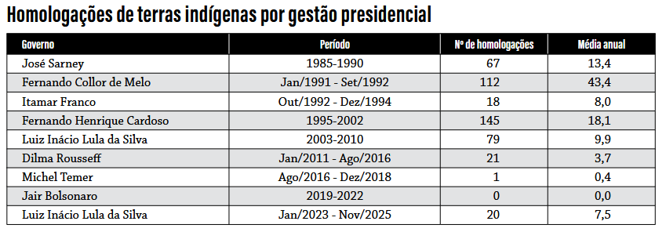

![note] This is an intermediate, reproducible analysis of land-rights pressure across ten Guarani-Kaiowá territories in Mato Grosso do Sul. It combines case records extracted programmatically from CIMI’s annual reports on violence against Indigenous peoples, FUNAI territory boundaries, and annual land-use and land-cover data from MapBiomas to examine how administrative delay, restricted community occupation, violence and agricultural expansion have developed between 2008 and 2025. The full workflow is available in our Soberana Land Rights Monitor [GitHub Repository](https://github.com/Soberana-Sensing/soberana-land-rights-monitor/tree/main/cimi).

[[toc]]

# Introduction

After the second round of the Brazilian presidential election on 25 October 2026, the Guarani-Kaiowá Indigenous communities in Mato Grosso do Sul (MS) reported a wave of violence: [threats to poison the water of the Sassoró village in Tacuru](https://g1.globo.com/ms/mato-grosso-do-sul/noticia/2026/11/01/ataque-a-indigenas-em-ms-o-que-se-sabe-sobre-ameacas-de-envenenamento-da-agua-em-aldeia.ghtml), [death threats](https://www.poder360.com.br/poder-brasil/governo-cria-forca-tarefa-para-apurar-ataques-a-indigenas-no-ms/), [hit-and-runs](https://agenciabrasil.ebc.com.br/direitos-humanos/noticia/2026-10/indigenas-de-ms-denunciam-casos-de-violencia-e-ameacas-apos-eleicao), and the [burning of the home and sacred objects of a 90-year-old spiritual leader in Jaguapiré](https://agenciabrasil.ebc.com.br/radioagencia-nacional/direitos-humanos/audio/2026-10/ms-indigenas-denunciam-ameacas-e-violencia-apos-resultado-de-eleicao). The Articulation of Indigenous Peoples of Brazil (APIB) had counted [more than 30 cases](https://www.poder360.com.br/poder-brasil/governo-cria-forca-tarefa-para-apurar-ataques-a-indigenas-no-ms/) of threats, attacks and hit-and-runs against Indigenous people in the state related to the 2026 election by the end of October. [Federal prosecutors opened investigations](https://www.mpf.mp.br/o-mpf/unidades/pr-ms/noticias/mpf-abre-investigacoes-sobre-onda-de-violencia-e-ataques-contra-comunidades-indigenas-em-mato-grosso-do-sul) and the [National Force was deployed to three villages](https://g1.globo.com/ms/mato-grosso-do-sul/noticia/2026/10/30/forca-nacional-faz-patrulhamento-em-aldeias-indigenas-de-ms-apos-ameacas-de-envenenamento-da-agua.ghtml). This recent surge of violence prompted the Soberana team to investigate how the land use and land cover (LULC) evolved inside the Guarani-Kaiowá territories within the MS state.

This analysis is primarily based on:

1. **CIMI reports (2009–2026)**: the annual [_Violence against Indigenous People in Brazil_](https://cimi.org.br/observatorio-da-violencia/edicoes-anteriores/) series, published by the missionary body of the Catholic Church in Brazil (CIMI). Each edition records, case by case and territory by territory, the attacks reported in the previous year.
2. **Geospatial data of the indigenous territories**, from [FUNAI](https://www.gov.br/funai), Brazil's federal Indigenous agency, downloaded as a single [WFS request](https://en.wikipedia.org/wiki/Web_Feature_Service) from [FUNAI's GeoServer](https://geoserver.funai.gov.br/geoserver/Funai/ows?service=WFS&version=2.0.0&request=GetFeature&typeNames=Funai:tis_poligonais_portarias&outputFormat=application/json&srsName=EPSG:4674&CQL_FILTER=uf_sigla%3D%27MS%27).
3. **MapBiomas land use and land cover (LULC)**, [collection 11](https://brasil.mapbiomas.org/colecoes-mapbiomas), which classifies the land of Brazil once a year from 1985 to 2025, with a spatial resolution of 30 m.

# Legal framework

Before diving into the report it is important to mention to the reader that an Indigenous land (Terra Indígena, TI) is an area the Brazilian State formally recognises as traditionally occupied by an Indigenous people. The 1988 Constitution recognises the Indigenous right to traditionally occupied land as an [original right, held before any private title existed](https://normas.leg.br/?urn=urn:lex:br:federal:constituicao:1988-10-05;1988!art231). This recognition follows the [fixed administrative sequence](https://www.gov.br/funai/pt-br/atuacao/terras-indigenas/demarcacao-de-terras-indigenas/fases-do-processo-administrativo) described in the table below.

| Status | What it means | Practical legal strength |
| --- | --- | --- |
| **Em estudo** (in study) | FUNAI is conducting anthropological, historical, land-tenure, cartographic and environmental studies to identify and delimit the Indigenous territory. | Weakest formal stage; the proposed perimeter is still under technical analysis and can change. |
| **Delimitada** (delimited) | The studies are complete and approved by FUNAI's presidency; the proposed limits are published in the federal and state official gazettes. | A formal proposed boundary exists, but it is not yet a presidentially declared Indigenous land. |
| **Declarada** (declared) | The Minister of Justice reviews the case and, if appropriate, declares the limits and orders physical demarcation through a *portaria* (decree) in the *Diário Oficial da União*. | The State has formally recognised the boundaries and ordered demarcation. |
| **Homologada** (ratified) | The materialised, georeferenced boundaries are published by presidential decree; the area is thereby constituted as a Terra Indígena (TI). | This is the decisive federal recognition of the TIs boundaries. |
| **Regularizada** (regularised) | After ratification, FUNAI helps the Secretariat of Federal Patrimony (SPU) register the area in the property registry and in SPU records. | Strongest administrative completion: the ratified territory has been formally registered. |

Non-Indigenous occupants of a ratified TI are [legally required to leave](https://www6g.senado.gov.br/apem/data/data/PROJ/71979.html). However, removal may be delayed until compensation has been paid for improvements made in good faith. Let is be noted that a territory only moves from declared to ratified by presidential decree.  CIMI's yearly report records the amount of TIs ratified per presidential term since 1985, shown in **Figure 1**.

# Areas of interest

CIMI's 2020 report recorded the area the indigenous community actually occupies within the Indigenous land as delimited by FUNAI for 10 distinct territories, shown in **Figure 2**. The figure highlights a large disparity in occupied land. The community of Ñande Ru Marangatu inhabited approximately 58% of their delimited territory in 2020, while in Iguatemipegua I and Guyraroka, they occupied less than 0.5% of the land. 

**Figure 3** showcases all Guarani-Kaiowá territories, within the state of Mato Grosso do Sul, according to FUNAI's geospatial data; the 10 we are focusing on are the ones presented in **Figure 2** and they are highlighted in blue.

The first chapter of each CIMI yearly report covers **violence against Indigenous heritage**: for example, disputes over land, delays in regularisation, and the use and degradation of natural resources. **Figure 4** summarises all cases across our areas of interest between 2008 and 2025. The figure shows a steep increase in violence related to land-right conflicts (dark blue) and possessory invasions (brown) in the past decade.

. The colour indicates the conflict type CIMI assigns to each case: disputes over territorial rights (dark blue), invasions of possession, illegal exploitation of natural resources and damage to property (brown), and omission and slowness in land regularisation (cyan). The number counts the cases in each territory-year.")

# Land use and land cover (LULC) analysis

We start by overlaying the ten delimited TI polygons downloaded from FUNAI's GeoServer with the MapBiomas collection 11 dataset, which classifies land use in 33 distinct classes. To keep the plots readable, we aggregated those 33 classes into the following eight groups: 

1. **Native vegetation**. It includes forest formation, floodable forest, savanna formation, flooded savanna, mangrove, wooded sandbank vegetation, grassland formation, herbaceous and shrub formation, wetland, salt marsh, herbaceous sandbank vegetation, hypersaline tidal flat and rocky outcrop.

2. **Pasture**. Grassland used for grazing.

3. **Agriculture**. It includes soybean, sugar cane, rice, cotton, other temporary crops, coffee, citrus, palm oil and other perennial crops. Likely by commercial agribusiness operations, particularly large-scale mechanised cropping.

4. **Mosaic of uses**. Land where crop fields, pasture and residual native vegetation are mixed too finely for the 30 m resolution to resolve, typical of smallholder properties such as Indigenous communities.

5. **Forest plantation**. Planted trees for commercial use, mostly eucalyptus and pine.

6. **Other non-vegetated areas**. It includes beach, dune and sand, urban area, exposed soil, mining, photovoltaic plant, wind farm and any other non-vegetated surfaces.

7. **Water**. It includes river, lake, ocean and aquaculture.

8. **Unclassified**. Pixels MapBiomas does not classify.

**Figure 5** shows the LULC change between 1985 and 2025 in the ten analysed Indigenous Territories. We observe that *native vegetation* reduced in eight of the ten territories, with two exceptions; Guyraroká and Taquara, where it increased by 684 ha and 407 ha, respectively. 

*Agriculture* expanded substantially in eight territories, whereas *pasture* declined in all of them. In four territories, agricultural expansion was largely offset by pasture loss: Dourados-Amambaipeguá I (+36,616 ha agriculture, −36,589 ha pasture), Guyraroká (+6,134/−6,989), Panambi–Lagoa Rica (+2,779/−2,713) and Taquara (+7,197/−8,266). In Jatayvary, the agricultural gain (+6,455 ha) was similar to the combined decline in pasture and mosaic areas (−3,008 and −2,932 ha, respectively). This pattern is consistent with the [commonly observed pasture-to-crop conversion in the region](https://link.springer.com/article/10.1007/s44274-024-00150-1?).

 inside the ten focus territories, 1985–2025. Each panel is a stacked area chart in hectares from MapBiomas Collection 11. Colours follow the eight groups used. The blue dashed line marks the year of the FUNAI's delimitation, the orange dashed line marks the year of the demarcation, and the continuous purple line marks the year of ratification.")

# Discussion

The ten territories studied reveal a persistent gap between the formal recognition of a TI boundary and the communities' effective access to, and control over, the land within that boundary. In 2020, CIMI recorded occupation shares ranging from 0.24% in Iguatemipegua I and less than 0.5% in Guyraroká to approximately 58% in Ñande Ru Marangatu and almost 60% in Arroio Kora. The two territories with the highest reported occupation—Arroio Kora and Ñande Ru Marangatu—are also the only two in this set that had been ratified. By contrast, the territories with the lowest occupation shares remained unratified: Iguatemipegua I and Panambi–Lagoa Rica were delimited in 2013 and 2011, respectively, with no subsequent declaration or ratification; Guyraroká, Jatayvary, Taquara, Sombrerito and Potrero Guasu were all declared before 2011, with no further progress for over a decade.

This correspondence does not prove causation: a low occupation share may result from eviction, restricted access, fear of violence, lack of resources to establish a community, or the practical impossibility of occupying land still used by others. Nevertheless, the pattern is coherent. Communities with little effective presence inside a delimited polygon are also those whose legal recognition has remained incomplete for the longest periods. In such conditions, the territory exists administratively on maps, but much of its land remains under agricultural or pastoral use rather than under community control.

The LULC results reinforce this reading. At the scale analysed here, agriculture is not a land-cover category that can be attributed to individual households or smallholder cultivation. Large, continuous cropland in Mato Grosso do Sul [is overwhelmingly associated with commercial production, particularly soy, maize and other mechanised commodity crops](https://www.scielo.br/j/sn/a/KpPh3RDPByztWjq5m5dJxfC/?lang=en). Where communities occupy only a small fraction of a territory while agriculture expands across the polygon, the most plausible interpretation is that an external commercial agribusiness is taking advantage of the land. Leasing is one way in which land can remain under external productive use, despite its formal delimitation as a TI. However, [Brazilian law prohibits the lease of Indigenous lands to non-Indigenous people, and Article 231(6) of the Constitution declares void acts of occupation or exploitation of Indigenous lands](https://www.planalto.gov.br/ccivil_03/leis/l6001.htm). A lease does not therefore become lawful through consent, payment, or a formal contract. 

The increase in CIMI-recorded land-rights conflicts and possessory invasions after 2019 is most visible in Dourados-Amambaipeguá I, Guyraroká and Panambi–Lagoa Rica. These territories remain unratified, and Dourados-Amambaipeguá I was only delimited in 2016. In all three, communities occupied a minority of the delimited area in 2020. Guyraroká is particularly illustrative. Its land was delimited in 2004 and declared in 2009, but ratification has still not occurred nearly two decades later. The territory lies within an [intensive soy-producing region and reporting describes the displacement of cattle pasture by soy and maize rotations](https://ms.cut.org.br/noticias/cut-ms-e-movimentos-sociais-lancam-campanha-de-solidariedade-aos-guarani-e-kaiow-6f45), which aligns with the offset we see in the LULC analysis. Given the community’s minimal occupation share and the scale of mechanised commodity production in the region, this points to commercial agricultural use of land that the community does not effectively control.

The same pattern appears in Taquara, Sombrerito, Panambi–Lagoa Rica and Dourados-Amambaipeguá I. In Taquara, agriculture appears to offset pasture and now accounts for most of the land use; in Sombrerito, pasture declines after declaration while agriculture increases; in Panambi–Lagoa Rica, both uses continue largely uninterrupted after delimitation; and in Dourados-Amambaipeguá I, agriculture has steadily replaced pasture since 1986. In each case, the community occupied only 3.2% to 19.4% of the delimited territory in 2020. The data therefore indicate that agricultural expansion has continued inside territories where communities lack both full legal recognition and effective possession.

Ñande Ru Marangatu shows that ratification does not automatically secure land. The territory was declared in 2002 and ratified in 2005, and the community occupied approximately 58% of it in 2020. The LULC series records a steep post-ratification decline in pasture, followed by renewed pasture and agricultural expansion from around 2017. CIMI reported that, after a federal court decision affected the demarcation’s effects, [farmers invaded areas already under Indigenous possession, moved FUNAI demarcation signs and carried out agricultural activities](https://cimi.org.br/wp-content/uploads/2022/01/report-violence-against-the-indigenous-peoples-in-brazil_2020-cimi.pdf).

Reporting on Ñande Ru Marangatu identifies [soy production through leasing arrangements, with communities receiving limited economic returns](https://acervo.socioambiental.org/acervo/noticias/zeca-do-pt-denuncia-abandono-de-terra-indigena-em-antonio-joao-sem-agua-e-casa). It also documents the political and economic networks surrounding the territory: the *De Olho nos Ruralistas* investigation [found that the Fronteira farm overlaps Ñande Ru Marangatu and was associated with the deaths of Simião Vilhalva in 2015, Dorvalino da Rocha in 2005 and Marçal de Souza Tupã-i in 1983](https://deolhonosruralistas.com.br/2023/06/14/politicos-e-seus-familiares-possuem-96-mil-hectares-sobrepostos-a-terras-indigenas/); it further reports that [Luana Ruiz, an heir to the farm’s owners, later joined the Bolsonaro government’s transition team and became assistant secretary for Land Affairs at the Ministry of Agriculture](https://deolhonosruralistas.com.br/2023/06/14/politicos-e-seus-familiares-possuem-96-mil-hectares-sobrepostos-a-terras-indigenas/). The broader [Invaders dossier identified 42 politicians and first-degree relatives with rural properties overlapping Indigenous territories](https://deolhonosruralistas.com.br/wp-content/uploads/2023/06/Os_Invasores_Politicos_2023.pdf).

These findings matter because they show that the pressure on Ñande Ru Marangatu was not only a local land dispute. It was embedded in political representation, landownership, agribusiness interests and state institutions. The renewed expansion of pasture and agriculture after 2017 is therefore consistent with a territory in which formal recognition was undermined by litigation, invasion and continued commercial use.

Arroio Kora differs from the low-occupation territories. It was delimited in 2004, declared in 2006 and ratified in 2009, and the community occupied almost 60% of its land in 2020. Pasture has remained the dominant land use since 1985, with a slight decline after ratification. The continued dominance of pasture indicates that the territory’s principal productive use remains livestock grazing. In Arroio Kora, however, this is more plausibly explained by the legacy and continuation of extensive cattle ranching than by community-managed livestock across most of the territory. FUNAI [describes much of the territory as deforested and converted to brachiaria pasture for beef-cattle production](https://www.gov.br/funai/pt-br/acesso-a-informacao/servidores/termo-de-referencia-euroclima.pdf), while CIMI reported in 2020 that [the ratified territory remained widely invaded](https://cimi.org.br/2014/11/36712/). Historical reporting likewise [describes cattle ranches within the territory and Indigenous people working as farm labourers before later retakings](https://cimi.org.br/2012/08/33890). Arroio Kora therefore shows that ratification improved the community’s legal position, but did not by itself displace the cattle-ranching land use that had come to dominate the territory.

The analysis establishes three points. First, prolonged administrative delay has left several Guarani-Kaiowá territories unratified for years or decades, while their communities occupy only a small fraction of the delimited area. Second, agricultural expansion inside these territories is consistent with commercial production rather than community-scale cultivation, particularly where occupation shares are extremely low. Third, ratification improves the legal basis for territorial control but does not by itself prevent renewed invasion, litigation, deforestation or agricultural expansion.

The 2026 wave of threats and attacks is not an aberration, nor merely a post-election escalation. It is the acute political expression of a structural conflict that has been allowed to persist for decades: territories formally delimited but left unratified, communities confined to a fraction of the land they are entitled to occupy, and agricultural and pastoral production continuing across territories whose original inhabitants remain dispossessed. Therefore, legal recognition without effective possession does not end dispossession. It leaves communities exposed to the interests that profit from the land they are struggling to recover. Addressing this requires more than condemning individual attacks; it requires completing demarcation, enforcing Indigenous territorial rights, removing the conditions that allow external land use to persist, and treating Guarani-Kaiowá communities as rights-holders with authority over their territories and not as obstacles to profit-driven agricultural expansion.

# Resources

- Agência Brasil. (2026, October 30). *MS: indígenas denunciam ameaças e violência após resultado de eleição*. Radioagência Nacional. https://agenciabrasil.ebc.com.br/radioagencia-nacional/direitos-humanos/audio/2026-10/ms-indigenas-denunciam-ameacas-e-violencia-apos-resultado-de-eleicao

- Balduino, I. (2026, October 29). *Indígenas de MS denunciam casos de violência e ameaças após eleição*. Agência Brasil. https://agenciabrasil.ebc.com.br/direitos-humanos/noticia/2026-10/indigenas-de-ms-denunciam-casos-de-violencia-e-ameacas-apos-eleicao

- Brasil. (1973, December 19). *Lei nº 6.001, de 19 de dezembro de 1973 – Estatuto do Índio, art. 18*. https://www.planalto.gov.br/ccivil_03/leis/l6001.htm

- Brasil. (1988). *Constituição da República Federativa do Brasil de 1988, art. 231*. https://normas.leg.br/?urn=urn:lex:br:federal:constituicao:1988-10-05;1988!art231

- Capoane, V., & Fushimi, M. (2024). Devastation of the Cerrado of Mato Grosso do Sul and the advance of arenization in the Pardo River watershed. *Discover Environment, 2*, Article 111. https://doi.org/10.1007/s44274-024-00150-1

- CIMI – Conselho Indigenista Missionário. (n.d.). *Violência contra os povos indígenas no Brasil: edições anteriores (2009–2026)*. https://cimi.org.br/observatorio-da-violencia/edicoes-anteriores/

- CIMI – Conselho Indigenista Missionário. (2020). *Report: Violence against Indigenous Peoples in Brazil – 2020 data*. https://cimi.org.br/wp-content/uploads/2022/01/report-violence-against-the-indigenous-peoples-in-brazil_2020-cimi.pdf

- CIMI – Conselho Indigenista Missionário. (2012). *[Article on cattle ranches and Indigenous occupation in Arroio Korá]*. https://cimi.org.br/2012/08/33890

- CUT-MS – Central Única dos Trabalhadores de Mato Grosso do Sul. (2025, October 2). *CUT-MS e movimentos sociais lançam campanha de solidariedade aos Guarani e Kaiowá*. https://ms.cut.org.br/noticias/cut-ms-e-movimentos-sociais-lancam-campanha-de-solidariedade-aos-guarani-e-kaiow-6f45

- De Olho nos Ruralistas. (2023, June 14). *Políticos e seus familiares possuem 96 mil hectares sobrepostos a terras indígenas*. https://deolhonosruralistas.com.br/2023/06/14/politicos-e-seus-familiares-possuem-96-mil-hectares-sobrepostos-a-terras-indigenas/

- De Olho nos Ruralistas. (2023). *Os Invasores: parlamentares e seus financiadores possuem fazendas sobrepostas a terras indígenas*. https://deolhonosruralistas.com.br/wp-content/uploads/2023/06/Os_Invasores_Politicos_2023.pdf

- Esri. (n.d.). *Web Feature Service*. GIS Dictionary. https://support.esri.com/en-us/gis-dictionary/web-feature-service

- Fundação Nacional dos Povos Indígenas (FUNAI). (n.d.). *Fases do processo administrativo de demarcação de terras indígenas*. https://www.gov.br/funai/pt-br/atuacao/terras-indigenas/demarcacao-de-terras-indigenas/fases-do-processo-administrativo

- Fundação Nacional dos Povos Indígenas (FUNAI). (n.d.). *Terras Indígenas – polígonos por portarias (layer Funai:tis_poligonais_portarias)*. GeoServer FUNAI, WFS request filtered to Mato Grosso do Sul. Retrieved November 12, 2026. https://geoserver.funai.gov.br/geoserver/Funai/ows?service=WFS&version=2.0.0&request=GetFeature&typeNames=Funai:tis_poligonais_portarias&outputFormat=application/json&srsName=EPSG:4674&CQL_FILTER=uf_sigla%3D%27MS%27

- Fundação Nacional dos Povos Indígenas (FUNAI). (2023, June 23). *Termo de Referência para contratação de consultoria ambiental para elaboração de um projeto executivo de recuperação de áreas degradadas na Terra Indígena Arroyo Korá (MS)*. Programa EUROCLIMA. https://www.gov.br/funai/pt-br/acesso-a-informacao/servidores/termo-de-referencia-euroclima.pdf

- Godoy, T. (2025, January 18). *Zeca do PT denuncia abandono de terra indígena em Antônio João: ‘Sem água e casa’*. Midiamax, archived by Instituto Socioambiental (ISA). https://acervo.socioambiental.org/acervo/noticias/zeca-do-pt-denuncia-abandono-de-terra-indigena-em-antonio-joao-sem-agua-e-casa

- Lopes, N. (2026, November 1). *Ataque a indígenas em MS: o que se sabe sobre ameaças de envenenamento da água em aldeia*. G1. https://g1.globo.com/ms/mato-grosso-do-sul/noticia/2026/11/01/ataque-a-indigenas-em-ms-o-que-se-sabe-sobre-ameacas-de-envenenamento-da-agua-em-aldeia.ghtml

- Machado, M. (2026, October 30). *Força Nacional faz patrulhamento em aldeias indígenas de MS após ameaças de envenenamento da água*. G1. https://g1.globo.com/ms/mato-grosso-do-sul/noticia/2026/10/30/forca-nacional-faz-patrulhamento-em-aldeias-indigenas-de-ms-apos-ameacas-de-envenenamento-da-agua.ghtml

- MapBiomas. (2025). *Coleções MapBiomas: Collection 11 of annual land cover and land use maps of Brazil (1985–2025)*. https://brasil.mapbiomas.org/colecoes-mapbiomas

- Ministério Público Federal (MPF). (2026, October 28). *MPF abre investigações sobre onda de violência e ataques contra comunidades indígenas em Mato Grosso do Sul*. https://www.mpf.mp.br/o-mpf/unidades/pr-ms/noticias/mpf-abre-investigacoes-sobre-onda-de-violencia-e-ataques-contra-comunidades-indigenas-em-mato-grosso-do-sul

- Midiamax. (2026, January 18). *Zeca do PT denuncia abandono de terra indígena em Antônio João: ‘Sem água e casa’*. https://midiamax.com.br/politica/2026/zeca-pt-denuncia-abandono-terra-indigena-antonio-joao-sem-agua-casa/

- Poder360. (2026, October). *Governo cria força-tarefa para apurar ataques a indígenas no MS*. https://www.poder360.com.br/poder-brasil/governo-cria-forca-tarefa-para-apurar-ataques-a-indigenas-no-ms/

- Procuradoria da República em Mato Grosso do Sul. (2026, October 28). *MPF abre investigações sobre onda de violência e ataques contra comunidades indígenas em Mato Grosso do Sul*. Ministério Público Federal. https://www.mpf.mp.br/o-mpf/unidades/pr-ms/noticias/mpf-abre-investigacoes-sobre-onda-de-violencia-e-ataques-contra-comunidades-indigenas-em-mato-grosso-do-sul

- Soberana Sensing. (n.d.). *Soberana Land Rights Monitor: CIMI pipeline*. GitHub. https://github.com/Soberana-Sensing/soberana-land-rights-monitor/tree/main/cimi

- Senado Federal. (1989, January 24). *Bases históricas da Assembleia Nacional Constituinte 1987–1988: Artigo 231*. https://www6g.senado.gov.br/apem/data/data/PROJ/71979.html

- Souza Júnior, S. (2025, October 2). *CUT-MS e movimentos sociais lançam campanha de solidariedade aos Guarani e Kaiowá*. CUT-MS. https://ms.cut.org.br/noticias/cut-ms-e-movimentos-sociais-lancam-campanha-de-solidariedade-aos-guarani-e-kaiow-6f45

- Springer Nature. (2024). *Devastation of the Cerrado of Mato Grosso do Sul and the advance of arenization in the Pardo River watershed*. https://link.springer.com/article/10.1007/s44274-024-00150-1

- Wikipedia contributors. (n.d.). *Web Feature Service*. Wikipedia. https://en.wikipedia.org/wiki/Web_Feature_Service